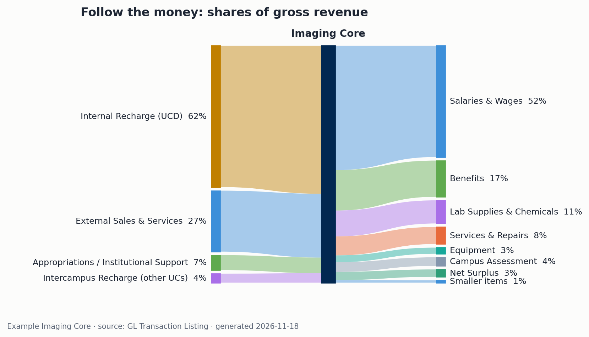
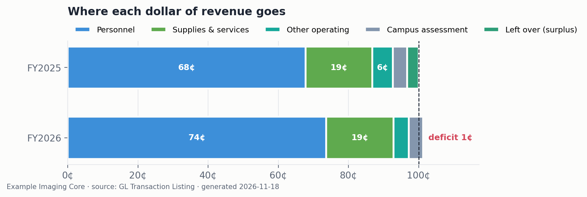
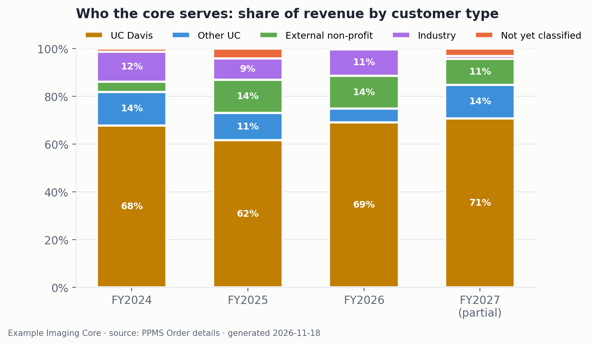

# ucd-core-financials

A Claude skill for UC Davis core facilities that bill through **PPMS (Stratocore)** and
keep their books in **Aggie Enterprise**. It tells a core exactly which reports to pull
and how, then turns those exports into:

- an interactive, self-contained **financial dashboard** (and a staff edition without
  personnel detail);
- **shareable figures** with no dollar amounts or names, ready for Cores Connect or campus
  meetings;
- **RCCI usership tables** (Tables 1 and 2) as an Excel workbook;
- a **publications check**: customers' papers that may use the core's data, which ones
  name the core, and labs to follow up with;
- an **unbilled-order check**, a **year-end forecast**, a **one-page summary** built only
  from checked numbers, and a **benchmark file** for comparing cores.

Every build reconciles its own arithmetic and reports any check that fails.

Built by the UC Davis Proteomics Core (Brett Phinney).

## Install

**Claude Code**

```bash
git clone https://github.com/bsphinney/ucd-core-financials-skill ~/ucd-core-financials-skill
ln -s ~/ucd-core-financials-skill ~/.claude/skills/ucd-core-financials
```

**claude.ai or Claude Desktop:** download `ucd-core-financials.zip` from the
[latest release](https://github.com/bsphinney/ucd-core-financials-skill/releases/latest)
and upload it under Settings → Capabilities → Skills.

Python 3.10+ with pandas, openpyxl, xlrd, matplotlib and PyYAML. Missing packages are
installed on first run.

## Use

Ask Claude something like *"Help me build financial reports for our core"* and it will
walk you through it. Or run the steps yourself:

```bash
python run.py init      my_core/   # writes core-config.yaml
python run.py inventory my_core/   # what's here, what's missing
python run.py affiliations my_core/ # guess customer types into affiliations.csv
python run.py build     my_core/   # everything into my_core/out/
python run.py publications my_core/ # customers' papers: does each name the core? (online)
python run.py combine   a/out/benchmark.csv b/out/benchmark.csv --out comparison/
```

Which reports to pull, and the email to send department finance staff if you'd rather
not pull them yourself: [reference/pulling-reports.md](reference/pulling-reports.md).

## Worked example

`sample_data/example_core/` is a fictional "Example Imaging Core". Every number and name
in it is made up.

```bash
python run.py build sample_data/example_core
```





## Privacy

- Everything runs locally on files you export. The one exception is `run.py publications`,
  which sends PI and submitter names to Europe PMC's public search and PI names to Crossref's.
  `build` never does.
- `out/share/` and `benchmark.csv` contain percentages, ratios, counts and days only:
  no dollar amounts, no lab, PI or person names.
- `dashboard.html`, `out/internal/` (including `publications.xlsx`), `usership.xlsx` and `facts.json` contain dollar
  amounts and lab names. Keep them inside the core and its finance staff.
- The staff edition removes individual salary and benefit accounts.
- GLIDE cardholder and traveller names are never read.
- Don't commit your own exports or outputs to a public repository.

## Documentation

- [SKILL.md](SKILL.md): the workflow Claude follows
- [Pulling the reports](reference/pulling-reports.md)
- [How every figure is calculated](reference/calculations.md)
- [core-config.yaml](reference/config.md)
- [Figure catalog](reference/figures.md)

## Development

```bash
pip install -r requirements.txt pytest
python -m pytest
python sample_data/generate.py   # regenerate the fictional sample
```

MIT licence. Chart.js and its plugins are bundled under their own MIT licences
(`assets/vendor/LICENSES.md`).
